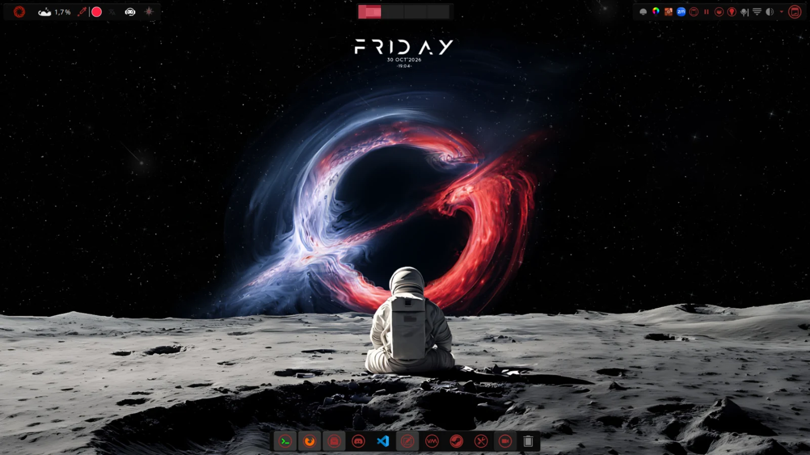
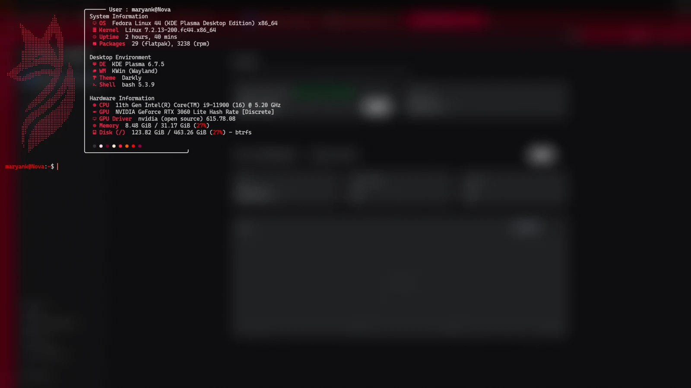
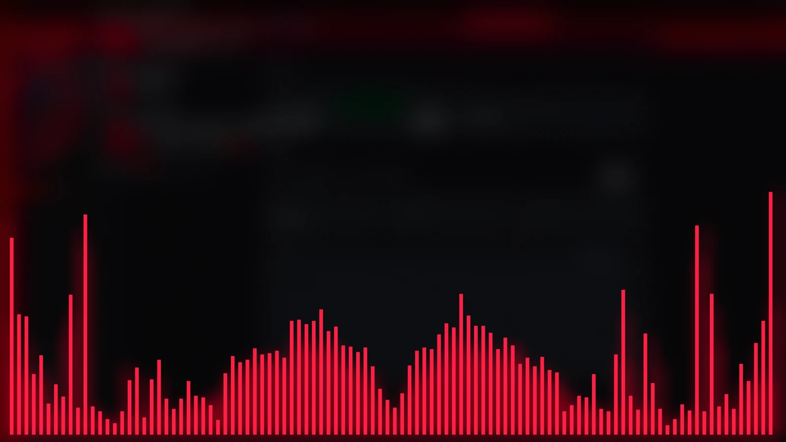

# RetroDark

Dotfiles de un escritorio **KDE Plasma 6 sobre Fedora 44**: tema oscuro
cyberpunk, terminal Kitty con translucidez real, un tema propio para OpenCode
con acento `#FF2044` y un puñado de utilidades domésticas.

Todo es **configuración declarativa**: `install.sh` enlaza ficheros del
repositorio en tu `$HOME` y deja copia de lo que sustituye. Nada se compila,
nada se instala como servicio.



| Terminal | Cava |
|---|---|
|  |  |

---

## Requisitos

| | |
|---|---|
| Sistema | Fedora 44 (debería funcionar en cualquier Fedora con Plasma 6) |
| Escritorio | KDE Plasma 6 |
| Imprescindible | `bash`, `git` |
| Opcional | `kitty`, `opencode`, `cava`, `OpenRGB`, `ardour9`, `kate`, `ffmpeg`, `piper` |

`manifest.txt` decide qué se instala. Si no usas una aplicación, comenta su
línea y no se toca nada de ella.

---

## Instalación

```bash
git clone https://github.com/MaryanK00/RetroDark_Theme_Fedora44_KDE_Dotfiles.git ~/dotfiles
cd ~/dotfiles
./install.sh
```

El instalador:

1. Copia a `~/.dotfiles-backup/<fecha>/` todo lo que va a sustituir.
2. Crea symlinks desde `$HOME` hacia `files/`.
3. Renderiza las plantillas `.tmpl` en `rendered/` y enlaza el resultado.
4. Genera los sonidos de OpenCode si encuentra el tema de Nier instalado.
5. Deja `lanctl` y `morning-briefing` en `~/.local/bin`.

Es idempotente: puedes ejecutarlo tantas veces como quieras. Y no recrea un
symlink que ya apunta al repositorio, para no romper a los procesos que lo
vigilan.

Después, cierra la sesión de Plasma y vuelve a entrar (o recarga pieza por
pieza, ver [Problemas frecuentes](#problemas-frecuentes)).

Para instalarlo en otro equipo: clona y repite. Las rutas se resuelven solas.

---

## Qué se instala

| Destino | Contenido |
|---|---|
| `~/.bashrc`, `~/.bash_profile`, `~/.bash_logout` | shell; añade `~/.local/bin` y `~/.opencode/bin` al `PATH` |
| `~/.bashrc.d/opencode-secrets.sh` | carga `~/.config/opencode/secrets.env` si existe |
| `~/.gitconfig` | git con LFS y credenciales de `gh` |
| `~/.tmux.conf`, `~/.gtkrc-2.0` | tmux y GTK 2 |
| `~/.config/kitty/` | tema *Hachiko*, opacidad 0.4, desenfoque, Cascadia Code NF |
| `~/.config/kdedefaults/` | valores por defecto de Plasma: kwinrc, plasmarc, kdeglobals, kcminputrc, ksplashrc |
| `~/.config/plasma-org.kde.plasma.desktop-appletsrc` | paneles, widgets, fondos y Konsole |
| `~/.config/gtk-3.0/` | tema GTK 3 con los botones de ventana a juego |
| `~/.config/cava/` | visualizador de audio con shaders |
| `~/.config/kate/externaltools/` | 18 herramientas externas para Kate |
| `~/.config/OpenRGB/`, `~/.config/ardour9/` | perfiles de RGB y de Ardour |
| `~/.config/opencode/` | tema `retro-dark`, sonidos, `cli.json`, `opencode.json`, `AGENTS.md`, MCP de GitHub y el plugin de voz |
| `~/.config/morning-briefing/` | configuración del saludo matinal |
| `~/.config/autostart/morning-briefing.desktop` | lanza el saludo al iniciar sesión |
| `~/.local/bin/lanctl`, `~/.local/bin/morning-briefing` | las dos utilidades del repo |

El detalle del escritorio —tema *Hachiko*, capa `kdedefaults`, perfil de
OpenRGB— está en [`docs/escritorio-kde.md`](docs/escritorio-kde.md).

### OpenCode

`opencode.json` y `cli.json` se renderizan como plantillas. Lo que configuran:

- **Permisos**: se bloquea la lectura de `secrets.env`, `~/.ssh/*` y el secreto
  del router, y se pide confirmación para `sudo`, `rm -rf`, `git push`,
  `curl` y cualquier comando que toque un secreto.
- **MCP**: `context7` (documentación), `github` (repos, issues, PRs) y
  `playwright` (navegador). El token de GitHub se lee del keyring de `gh auth
  login`; nunca se escribe en disco.
- **Plugins**, con versión fijada en vez de `@latest`: `opencode-dcp`,
  `context7-opencode`, el dictado y el plugin local de voz.
- **Voz**: locución de las respuestas y dictado local con Whisper.
  Instalación, atajos y diagnóstico en [`docs/voz.md`](docs/voz.md).

La guía larga de esta parte es [`docs/opencode.md`](docs/opencode.md).

---

## Personalización

### Datos personales

La configuración del saludo matinal viene sin ubicación. Para tener el tiempo
del día, crea el fichero local (no versionado, permisos `600`):

```bash
mkdir -p ~/.config/morning-briefing
cat > ~/.config/morning-briefing/local.conf <<'EOF'
CIUDAD="Tu ciudad"
LAT="00.0000"
LON="0.00000"
EOF
chmod 600 ~/.config/morning-briefing/local.conf
```

`local.conf` se lee **después** de `~/.config/morning-briefing/config`, así que
sus valores mandan. Sin él, el saludo sigue funcionando y omite el tiempo.

### Plantillas

Los `.tmpl` se renderizan durante la instalación:

| Marcador | Sustituye a |
|---|---|
| `__HOME__` | tu directorio home |
| `__GIT_NAME__` | `git config --global user.name` |
| `__GIT_EMAIL__` | `git config --global user.email` |

### Añadir o quitar configuración

`manifest.txt` es la lista blanca: una línea por fichero, tabulada.

```
# origen en files/            destino en ~                    modo
bashrc.tmpl                   .bashrc                          template
config/kitty/kitty.conf       .config/kitty/kitty.conf         link
```

- `link` — symlink directo al fichero del repositorio.
- `template` — se renderiza en `rendered/` y se enlaza la copia.
- `generated` — lo produce un script (los WAV); si aún no existe, se omite.

Para retirar algo, comenta la línea y vuelve a ejecutar `./install.sh`.

---

## Utilidades

### `lanctl`

CLI en Python (solo biblioteca estándar) para manejar los dispositivos de la
red local: Fire TV por ADB, TV Hisense por Chrome DevTools, router OpenWrt por
ubus, más escaneo, inventario, ping, WoL y capturas.

```bash
lanctl discover --rapido      # escanea la red y guarda el inventario
lanctl ls                     # qué hay conectado
lanctl ver                    # qué se ve en cada TV
lanctl escena netflix         # enciende la TV, HDMI1, Netflix
lanctl play netflix 80100172  # una peli concreta
```

No necesita `root` ni daemons. Guía completa en
[`docs/lanctl.md`](docs/lanctl.md) y
[chuleta de comandos](docs/lanctl-cheatsheet.md).

### `morning-briefing`

Saludo hablado al iniciar sesión: fecha, hora, tiempo, índices y titulares,
con la misma voz que OpenCode. Habla una vez al día y, si algo falla, no rompe
nada.

```bash
morning-briefing --dry-run   # imprime el texto, sin sonido
morning-briefing --now       # habla ahora, sin gastar el saludo del día
morning-briefing --reset     # borra el sello: el próximo arranque habla
```

Guía en [`docs/parte-matinal.md`](docs/parte-matinal.md).

---

## Seguridad y privacidad

El repositorio **no contiene credenciales ni datos personales**. Quedan fuera
a propósito:

- claves GPG, keyrings, tokens de sesión y la base de datos de OpenCode.
- perfiles de navegador, historiales de shell y cachés.
- los sonidos de Nier: son de sus autores y se generan en local.
- la ubicación del usuario: va en `local.conf`, fuera del repo.

Y hay un `pre-commit` que lo vigila:

- `gitleaks` y `scripts/scan-secrets.sh` bloquean credenciales.
- se rechazan MACs reales y coordenadas.
- se rechazan rutas `/home/<usuario>`: hay que usar `__HOME__`.
- se rechazan ficheros de más de 1 MB.

Antes de publicar, compruébalo tú mismo:

```bash
gitleaks detect --source . --redact
bash scripts/scan-secrets.sh .
```

---

## Estructura

```
.
├── install.sh              instala: symlinks, plantillas y backups
├── restore.sh              revierte la instalación
├── manifest.txt            lista blanca de lo que se instala
├── files/                  la configuración, con la estructura de destino
├── scripts/
│   ├── lanctl              control de la red local
│   ├── morning-briefing    saludo matinal hablado
│   ├── make-sounds.sh      genera los WAV desde el tema de Nier
│   ├── scan-secrets.sh     escáner de credenciales propio
│   ├── install-voice.sh    instala piper, voz, Whisper y VAD
│   ├── patch-voice-plugin.sh   apaga la TUI del plugin de dictado
│   └── test-voice-tui.mjs  test de humo de la mitad TUI
├── docs/
│   ├── escritorio-kde.md   Plasma, Kitty, Cava, tmux
│   ├── opencode.md         configuración, MCP, plugins y permisos
│   ├── voz.md              dictado y locución
│   ├── parte-matinal.md    el saludo matinal
│   ├── lanctl.md           la CLI de la red local
│   ├── lanctl-cheatsheet.md  chuleta de comandos
│   └── img/                capturas del README
├── hooks/pre-commit        gitleaks, tamaño y datos personales
└── rendered/               copias renderizadas (no se versiona)
```

---

## Desinstalar

```bash
./restore.sh
```

Retira los symlinks y ofrece restaurar la última copia de
`~/.dotfiles-backup/`. Los ficheros que hayas editado a mano no se tocan.

---

## Problemas frecuentes

| Síntoma | Qué hacer |
|---|---|
| Kitty no cambia de tema | `Ctrl+Shift+F5` recarga la configuración |
| Plasma sigue igual | Cerrar sesión y volver a entrar, o `plasmashell --replace` |
| OpenCode no ve el tema | Reiniciar la TUI: los temas se leen al arrancar |
| Cava termina con *core dumped* | Necesita un TTY; lánzalo dentro de Kitty o de tmux |
| El saludo matinal no suena | `morning-briefing --dry-run` y revisar `~/.local/state/morning-briefing/last-run` |
| El instalador avisa de un origen que falta | Esa línea del `manifest.txt` apunta a un fichero que no existe: coméntala |

---

## Créditos

- [kitty](https://sw.kovidgoyal.net/kitty/) y el tema *Hachiko*, de Mert18
- [OpenCode](https://opencode.ai) y su formato de temas
- [Fedora](https://fedoraproject.org), [KDE Plasma](https://kde.org)
- [Cava](https://github.com/karlstav/cava), [OpenRGB](https://openrgb.org),
  [Kate](https://kate.kde.org), [Ardour](https://ardour.org)
- [piper](https://github.com/rhasspy/piper) y
  [sherpa-onnx](https://github.com/k2-fsa/sherpa-onnx) para la voz y el dictado
- Los sonidos de *NieR: Automata* pertenecen a sus autores originales; aquí
  solo se incluye el script que los prepara.

## Licencia

[MIT](LICENSE). Los recursos de terceros (fuentes, sonidos, temas) mantienen
sus propias licencias.
